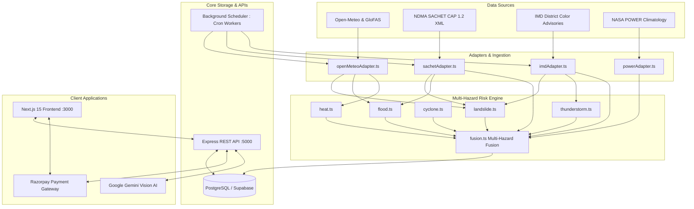

# 🌾 AgroSafe Travel — Disaster-Resilient Agrotourism Platform

> **Safe, verified farmstays in hazard-prone terrain (Himalayas, Western Ghats, Coastal Belts) with deterministic multi-hazard intelligence, automated financial escrow, and AI-assisted disaster response.**

[](https://nodejs.org)
[](https://nextjs.org)
[](https://www.typescriptlang.org)
[](https://www.docker.com)
[](https://razorpay.com)
[](https://ai.google.dev)
[](https://supabase.com)

---

## 📑 Table of Contents

1. [System Overview & Core Invariants](#-system-overview--core-invariants)
2. [Technology Stack](#-technology-stack)
3. [Architecture & Data Pipelines](#-architecture--data-pipelines)
4. [Quickstart: Launching the Entire Platform](#-quickstart-launching-the-entire-platform)
   - [Method 1: Docker Compose (Recommended)](#method-1-docker-compose-recommended)
   - [Method 2: Local Development Setup](#method-2-local-development-setup)
5. [Database Seeding & Default Credentials](#-database-seeding--default-credentials)
6. [Complete Step-by-Step Feature Testing Guide](#-complete-step-by-step-feature-testing-guide)
   - [Feature 1: Multi-Hazard Risk Scoring & Live Forecast Horizons](#feature-1-multi-hazard-risk-scoring--live-forecast-horizons)
   - [Feature 2: 15-Minute Atomic Seat Inventory Hold](#feature-2-15-minute-atomic-seat-inventory-hold)
   - [Feature 3: Razorpay Payment & AgroSafe Escrow Vault](#feature-3-razorpay-payment--agrosafe-escrow-vault)
   - [Feature 4: Google Gemini Vision Hazard Classification](#feature-4-google-gemini-vision-hazard-classification)
   - [Feature 5: Path B 7-Factor Citizen Photo Verification & Moderation Desk](#feature-5-path-b-7-factor-citizen-photo-verification--moderation-desk)
   - [Feature 6: Path A Official Alert Broadcast & Guest "I'm Safe" Check-In](#feature-6-path-a-official-alert-broadcast--guest-im-safe-check-in)
   - [Feature 7: Weather-Aware Zero-Fee Rescheduling & Emergency Refunds](#feature-7-weather-aware-zero-fee-rescheduling--emergency-refunds)
7. [Automated Verification Test Suites](#-automated-verification-test-suites)
8. [Environment Configuration Reference](#-environment-configuration-reference)
9. [Repository Structure](#-repository-structure)

---

## 🛡️ System Overview & Core Invariants

AgroSafe Travel addresses the dual danger of agrotourism in mountainous and vulnerable ecosystems: **physical safety risks** from landslides, flash floods, extreme heat, and cyclones, and **financial travel risks** from non-refundable bookings during natural hazards.

The platform operates on seven non-negotiable architectural invariants:

1. **Deterministic Rule Engine (No Black-Box ML for Hazard Ratings)**: Risk scores are calculated using auditable mathematical thresholds (e.g., IMD rainfall categories, GloFAS river discharge percentiles, slope incline degrees, and the Rothfusz Heat Index formula).
2. **Official Alert Floor**: Rules can elevate hazard levels based on local real-time sensors, but **can never lower an official warning** issued by IMD, NDMA SACHET, CWC, or INCOIS.
3. **No Default "Safe" Fallback**: If meteorological or satellite feeds are unavailable or older than 24 hours, the system strictly tags the score as `"Insufficient data / Low confidence"` instead of defaulting to Green.
4. **15-Minute Atomic Inventory Hold**: Prevents seat double-booking during checkout. Farm availability is atomically decremented upon hold creation and automatically released if payment is not confirmed within 15 minutes.
5. **AgroSafe Escrow Vault**: Guest payments are held in escrow rather than paid out immediately to hosts. Funds are released only after safe check-in, or refunded at 100% zero-penalty upon disaster warnings.
6. **Weather-Aware 100% Fee Waiver**: Guests with stays within 72 hours of an Orange or Red official alert receive an automatic waiver of all cancellation and rescheduling fees.
7. **Path B Multi-Signal Photo Verification**: Crowd-sourced landslide and hazard photos are scrutinized across 7 independent cryptographic and environmental signals (EXIF GPS vs. device GPS, live camera hardware capture, timestamp freshness, IMD rainfall corroboration, pHash deduplication, and Google Gemini Vision classification) before routing to a human moderation desk.

---

## 💻 Technology Stack

| Layer | Technologies |
| :--- | :--- |
| **Frontend** | Next.js 15 (App Router), React 19, TypeScript, Tailwind CSS v4, Lucide Icons, Standalone Output |
| **Backend** | Node.js (v20/v22), Express 4, TypeScript, Zod Schema Validation, Tsx |
| **Database** | Supabase (PostgreSQL 15) with Row-Level Security, Spatial Triggers, Audit Logs, and Resilient In-Memory Fallback |
| **AI / Vision** | Google Gemini 2.5 Flash Vision (`@google/genai` SDK) with heuristic visual fallback |
| **Payments** | Razorpay Node.js SDK (UPI, PhonePe, Google Pay, Paytm, RuPay, Netbanking, Cards) + HMAC-SHA256 Webhook Verification |
| **External Feeds** | Open-Meteo API (16-day numerical weather), GloFAS (River discharge), NDMA SACHET (CAP 1.2 XML), IMD (District color warnings & nowcasts), NASA POWER (10-year climatology) |
| **DevOps** | Docker, Docker Compose, Multi-Stage Alpine Builds, Healthcheck Probes |

---

## 🏗️ Architecture & Data Pipelines



---

## 🚀 Quickstart: Launching the Entire Platform

### Prerequisites
- **Git**
- **Node.js**: v20.0.0 or higher (v22 recommended)
- **Docker & Docker Compose**: (Optional, for containerized run)
- **Supabase Account**: (Optional — the backend includes an automatic offline in-memory fallback mode)
- **Google Gemini API Key**: (Optional — automated fallback heuristics run if key is omitted)
- **Razorpay Key & Secret**: (Optional — preloaded test keys work in trial sandbox mode)

---

### Method 1: Docker Compose (Recommended)

Run both the frontend and backend in isolated, health-checked containers with a single command:

```bash
# 1. Clone the repository
git clone git@github-personal:gavendra15s/Agro-full.git
cd Agro-full

# 2. Configure environment variables (pre-filled with working defaults)
cp backend/.env.example backend/.env

# 3. Build and launch all services
docker compose up --build -d

# 4. View container status
docker compose ps

# 5. Tail live logs
docker compose logs -f
```

- **Frontend Application**: `http://localhost:3000`
- **Backend API & Health**: `http://localhost:5000/health`
- **To stop containers**: `docker compose down`

---

### Method 2: Local Development Setup

If running directly on your host machine:

#### Step 1: Start Backend API Server
```bash
cd backend

# Install dependencies
npm install

# Setup environment
cp .env.example .env

# Verify environment and launch dev server with hot reload
npm run dev
```
*Backend runs at `http://localhost:5000`. You will see background jobs initialize (SACHET 10m, IMD 15m, Hold Release 2m).*

#### Step 2: Start Frontend Application
In a separate terminal:
```bash
cd frontend

# Install dependencies
npm install

# Run Next.js 15 development server
npm run dev
```
*Frontend runs at `http://localhost:3000`.*

---

## 🗄️ Database Seeding & Default Credentials

### How Database Seeding Works

The database setup supports two operating modes:
1. **Live Supabase PostgreSQL Mode**: Connects to your live Supabase project by configuring `SUPABASE_URL` and `SUPABASE_SERVICE_ROLE_KEY` in `backend/.env`.
2. **Resilient Local Mock Mode**: If Supabase credentials are placeholder values or offline, `backend/src/config/supabase.ts` automatically activates an in-memory database with pre-seeded farms, users, and safety profiles.

### Running Migrations and Seeding on Live Supabase

1. Open your **Supabase Dashboard → SQL Editor**.
2. Run [`backend/supabase/schema.sql`](file:///media/shashi/New-Volume/Agro-full/backend/supabase/schema.sql) — sets up the core tables (`users`, `farms`, `bookings`, `payments`, `warnings`, `escrows`).
3. Run [`backend/supabase/migrations/003_system_architecture_upgrade.sql`](file:///media/shashi/New-Volume/Agro-full/backend/supabase/migrations/003_system_architecture_upgrade.sql) — creates multi-hazard tables (`farm_static_profile`, `official_alerts`, `hazard_scores`, `incident_reports`, `report_signals`, `moderation_actions`, `alert_deliveries`).
4. Run the seed script via terminal:
   ```bash
   cd backend
   npm run seed
   ```
   *Or paste [`backend/supabase/seed.sql`](file:///media/shashi/New-Volume/Agro-full/backend/supabase/seed.sql) into the Supabase SQL Editor.*

### Pre-Seeded Test Accounts

All pre-seeded test accounts use the password: `password123`

| Role | Name | Email | Default Password | Permissions |
| :--- | :--- | :--- | :--- | :--- |
| **Host** | Rohit Bisht | `rohit.bisht@example.com` | `password123` | Farmstay host (Ramgarh Orchard), can issue local warnings |
| **Host** | Vikram Singh | `vikram.singh@example.com` | `password123` | Farmstay host (Mukteshwar Pines), view guest bookings |
| **Guest** | Arjun Verma | `arjun.verma@example.com` | `password123` | Bookings, Escrow hold, "I'm Safe" check-in, photo reports |
| **Guest** | Pooja Sharma | `pooja.sharma@example.com` | `password123` | Bookings, zero-fee weather rebooking |
| **Admin** | System Admin | `admin@example.com` | *Custom* | Full access to `/admin` moderation queue & CAP 1.2 simulation |

> **To create a custom Admin account via CLI**:
> ```bash
> cd backend
> npm run create-admin -- admin@agrosafe.travel SecurePass123 Admin User +919876543299
> ```

---

## 🔍 Complete Step-by-Step Feature Testing Guide

Follow this guide to verify every feature of the platform from scratch.

---

### Feature 1: Multi-Hazard Risk Scoring & Live Forecast Horizons

**How it works**: When a user views a farmstay, the platform queries `GET /api/farms/:slug/risk?date=YYYY-MM-DD`. The fusion engine evaluates 5 hazards and labels the prediction horizon with confidence tags:
- **0–3 Days (High Confidence)**: Live numerical weather prediction + satellite soil moisture.
- **4–7 Days (Medium Confidence)**: Medium-range ensemble models.
- **8–15 Days (Advisory / Low Confidence)**: Extended numerical trends.
- **> 15 Days (Climatology Baseline)**: Historical 10-year monthly averages from NASA POWER.

**How to test**:
1. Open your browser to `http://localhost:3000/farms/himalayan-organic-orchard`.
2. Locate the **Multi-Hazard Safety Matrix** card beside the farm details.
3. Change the target stay date using the date selector:
   - Select a date **within 3 days**: Observe the `HIGH CONFIDENCE` badge and live hazard breakdown (Landslide, Flood, Extreme Heat, Wind/Cyclone, Thunderstorms).
   - Select a date **>15 days in the future**: Observe how the system automatically switches to `HISTORICAL CLIMATOLOGY TREND` with an advisory note.
4. Expand individual hazard accordions to view the exact deterministic rules and reasoning strings generated by the engine.

---

### Feature 2: 15-Minute Atomic Seat Inventory Hold

**How it works**: When a guest initiates booking, `POST /api/bookings/hold` atomically reserves capacity in `availability` and marks the booking as `Held` with `hold_expires_at = NOW() + 15 minutes`. Background worker `releaseExpiredHolds` runs every 2 minutes to reclaim unpaid capacity.

**How to test**:
1. On any farm page (e.g., `http://localhost:3000/farms/himalayan-organic-orchard`), select guest count and dates.
2. Click **Reserve & Hold in Escrow**.
3. You will be redirected to `/checkout?holdId=...`.
4. Observe the live **15-Minute Hold Countdown Timer** at the top of the checkout screen.
5. If you do not pay before expiry, the server releases the held room back into inventory.

---

### Feature 3: Razorpay Payment & AgroSafe Escrow Vault

**How it works**:
- The client calls `POST /api/payments/create-order` with the `holdId`.
- The backend initializes a Razorpay order in Indian Rupees (INR) with currency conversion and metadata.
- The user completes payment using the Razorpay UI (UPI QR code, Google Pay, PhonePe, Cards, or Netbanking).
- The payment response is cryptographically verified on `POST /api/payments/verify` using HMAC-SHA256 (`razorpay_order_id|razorpay_payment_id`).
- Upon success, the payment record is assigned status `Held_In_Escrow`. Funds are locked until safe stay completion or released/refunded on disaster events.

**How to test**:
1. On the `/checkout` page, review the pricing summary:
   - Stay cost, cleaning fee, and 1% AgroSafe Disaster Protection levy.
2. Click **Pay with UPI / Card (Razorpay)**.
3. The official Razorpay modal will open:
   - Select **UPI** → Enter any test VPA (e.g., `success@razorpay`) or select **Card** (use Razorpay test card `4111 1111 1111 1111`, expiry `12/28`, CVV `123`).
   - Click **Success** to simulate bank authorization.
4. The system validates the HMAC-SHA256 signature, logs the transaction in `payment_transaction_log`, transitions booking to `Confirmed`, and locks funds in `Held_In_Escrow`.
5. Visit `http://localhost:3000/bookings` to see your confirmed reservation with the **Escrow Vault Secured** badge.

---

### Feature 4: Google Gemini Vision Hazard Classification

**How it works**: When an image is uploaded through the citizen hazard report portal, `aiVisionService` calls Google Gemini 2.5 Flash Vision. The model detects hazards (mudflow, road collapse, fallen boulders, waterlogging), verifies whether the visual evidence aligns with the user's claimed category, scores confidence (0–100%), and provides an explanation.

**How to test via CLI**:
```bash
cd backend
npx tsx src/scripts/testGemini.ts
```
*Expected Output*: Displays detected hazard category, alignment flag, visual reason, and execution duration in milliseconds.

**How to test via Web UI**:
1. Open `http://localhost:3000/report`.
2. Select **Landslide / Mudflow** and choose a farm location.
3. Upload a photo of a road obstruction or landslide.
4. Submit the report. Gemini Vision analyzes the photo in real-time, extracts visual features, and attaches the AI classification signal to the report.

---

### Feature 5: Path B 7-Factor Citizen Photo Verification & Moderation Desk

**How it works**: Before crowd-sourced hazard photos trigger public evacuation alerts, `photoVerificationService` evaluates seven independent credibility signals:
1. **GPS Spatial Delta**: EXIF GPS coordinates vs. device GPS (must be < 500m).
2. **In-App Camera Capture**: Live camera hardware verification vs. file gallery upload.
3. **Capture Freshness**: EXIF timestamp vs. upload time (< 15 minutes).
4. **IMD Rainfall Corroboration**: Checks if official IMD rainfall is actively occurring in that district.
5. **Official Alert Corroboration**: Checks if an active SACHET/IMD alert exists in the vicinity.
6. **Duplicate Image Detection**: Computes perceptual hash (pHash) against previous reports.
7. **AI Vision Verification**: Google Gemini Vision visual match score.

**How to test**:
1. Submit a report at `http://localhost:3000/report` with the **Live Camera** toggle checked.
2. Sign in as Admin (`admin@example.com` / your admin credentials) and navigate to `http://localhost:3000/admin`.
3. Click the **Path B Photo Queue** tab.
4. Inspect the pending submission:
   - View the photo thumbnail, reporter trust score, and credibility breakdown.
   - Observe each green/red signal badge (+20 GPS match, +15 Live Camera, +12 AI Vision, etc.).
5. Click **Verify & Broadcast Alert**:
   - The report status transitions to `CONFIRMED`.
   - The platform creates an active warning broadcast to all guests in the affected radius.

---

### Feature 6: Path A Official Alert Broadcast & Guest "I'm Safe" Check-In

**How it works**: Official Common Alerting Protocol (CAP 1.2 XML) feeds from NDMA SACHET or IMD are ingested. The system runs ray-casting point-in-polygon tests to find farms within the hazard zone, creates an `official_alerts` record, and issues alert deliveries.

**How to test**:
1. In the Admin Dashboard (`http://localhost:3000/admin`), navigate to the **Simulate CAP Alert** tool.
2. Select **Chamoli, Uttarakhand**, set severity to **Orange (Warning)**, and trigger simulation.
3. Switch to a guest account and navigate to `http://localhost:3000/bookings`.
4. Observe the urgent **Official Weather & Safety Protocol** banner over your reservation:
   - Headline: *IMD Orange Alert: Flash Flood Warning for Chamoli*.
5. Click **Check-In: "I'm Safe"**:
   - Triggers `POST /api/safety/alerts/:id/ack`.
   - Records your safe status and timestamp in `alert_deliveries` so emergency responders know your safety state.

---

### Feature 7: Weather-Aware Zero-Fee Rescheduling & Emergency Refunds

**How it works**: Under invariant #6, any guest with a stay within 72 hours of an active Orange or Red alert is granted a 100% waiver of cancellation and rescheduling penalties (`can_rebook_or_cancel = true`).

**How to test**:
1. On `http://localhost:3000/bookings` with an active Orange/Red alert banner, click **Change Dates (Zero Penalty)**.
2. A rebooking modal opens showing a ₹0 change fee notice.
3. Pick alternative dates later in the season.
4. Click **Confirm Free Rebooking**:
   - Triggers `POST /api/bookings/:id/reschedule`.
   - The reservation updates immediately with no cancellation penalty, and your escrow balance is retained.
5. Alternatively, clicking **Request 100% Emergency Refund** automatically unlocks the AgroSafe Escrow Vault, returning the full transaction sum to your original payment method.

---

## 🧪 Automated Verification Test Suites

The repository includes comprehensive automated test suites guarding every critical invariant.

### 1. Run Complete Backend Unit & Invariant Tests
```bash
cd backend
npm test
```
**Test Coverage (26 tests, 16 suites — 100% passing)**:
- **Disaster-Aware Booking & Hold Engine**: Pricing maths, 15-minute seat holds, zero-fee weather rescheduling.
- **Payment Gateway & Webhook Signature Suite**: Razorpay HMAC-SHA256 signature verification, rawBuffer vs string support, tampering rejection.
- **Path B 7-Factor Photo Verification**: Credibility scoring, GPS mismatch penalties, 100-point invariant cap, Gemini AI vision fallback.
- **Multi-Hazard Risk Engine Verification**: Landslide rules (dry vs heavy rain vs steep slope), River flood discharge percentiles, Rothfusz Heat Index formula (>54°C triggers Red), Cyclone coastal distance (<50km), Thunderstorm Doppler nowcasts, and official alert floor invariants.

### 2. Run Comprehensive End-to-End System Simulation
```bash
cd backend
npx tsx src/test_system_e2e.ts
```
*Simulates all 4 core pipelines in sequence: Risk Engine evaluation → Path B photo scoring → Path A CAP alert simulation → Background worker source freshness.*

### 3. Run Frontend Pricing Math Check
```bash
cd frontend
npm run check
```
*Executes assert-based checks ensuring the booking card and checkout modal always calculate identical nightly totals, fees, and disaster levies.*

### 4. Run TypeScript Type & Lint Checks
```bash
# Backend lint
cd backend && npm run lint

# Frontend lint
cd frontend && npm run lint
```

---

## ⚙️ Environment Configuration Reference

### Backend (`backend/.env`)

| Variable | Description | Sample Value / Default |
| :--- | :--- | :--- |
| `PORT` | Express server port | `5000` |
| `NODE_ENV` | Runtime environment | `development` or `production` |
| `CLIENT_URL` | Allowed CORS frontend origin | `http://localhost:3000` |
| `SUPABASE_URL` | Supabase Project URL | `https://your-project.supabase.co` |
| `SUPABASE_ANON_KEY` | Supabase Anonymous Key | `your-supabase-anon-key` |
| `SUPABASE_SERVICE_ROLE_KEY` | Supabase Service Role Key (Admin) | `your-supabase-service-role-key` |
| `JWT_SECRET` | Secret key for JWT signing | `super-secret-jwt-key-agrosafe-2026` |
| `RAZORPAY_KEY_ID` | Razorpay Key ID | `rzp_test_xxxxxxxxxxxxxx` |
| `RAZORPAY_KEY_SECRET` | Razorpay Secret Key | `xxxxxxxxxxxxxxxxxxxxxx` |
| `RAZORPAY_WEBHOOK_SECRET` | Razorpay Webhook HMAC secret | `rzp_webhook_secret_agrosafe` |
| `GEMINI_API_KEY` | Google Gemini API Key | `AIzaSy...` |
| `SMTP_HOST` | SMTP server hostname | `smtp.gmail.com` |
| `SMTP_PORT` | SMTP server port | `465` |
| `SMTP_USER` | SMTP username / email address | `noreply@agrosafe.travel` |
| `SMTP_PASS` | SMTP app password | `app-password` |

### Frontend (`frontend/.env.local`)

| Variable | Description | Sample Value / Default |
| :--- | :--- | :--- |
| `NEXT_PUBLIC_API_URL` | Backend API URL accessible from browser | `http://localhost:5000/api` |
| `NEXT_PUBLIC_RAZORPAY_KEY_ID` | Public Razorpay key for checkout modal | `rzp_test_xxxxxxxxxxxxxx` |

---

## 📁 Repository Structure

```
Agro-full/
├── README.md                               # Master system documentation & test runbook
├── docker-compose.yml                      # Unified multi-container Docker orchestration
├── SYSTEM_UPGRADE_MANUAL.md                # Engineering architecture upgrade manual
├── CORE_ARCHITECTURE_AND_PINPOINT_FAQ.md   # Architectural design FAQ & invariant rules
│
├── backend/                                # Node.js / Express / TypeScript API server
│   ├── Dockerfile                          # Multi-stage production container build
│   ├── .dockerignore                       # Container build exclusions
│   ├── .env.example                        # Template environment variables
│   ├── package.json                        # Backend dependencies & test scripts
│   ├── src/
│   │   ├── adapters/                       # External meteorological & alert adapters
│   │   │   ├── baseAdapter.ts              # Resilient base adapter with circuit breaker
│   │   │   ├── openMeteoAdapter.ts         # Weather & GloFAS river discharge
│   │   │   ├── sachetAdapter.ts            # NDMA SACHET CAP 1.2 XML feed
│   │   │   ├── imdAdapter.ts               # IMD district color advisories & nowcasts
│   │   │   └── powerAdapter.ts             # NASA POWER 10-year climatology
│   │   ├── config/                         # Environment & Supabase database loaders
│   │   ├── controllers/                    # Route handlers (farms, bookings, payments, etc.)
│   │   ├── routes/                         # Express API route declarations
│   │   ├── scripts/                        # Database seed, admin generator, & Gemini test
│   │   ├── services/
│   │   │   ├── alertEngine/                # Path A official alerts & Path B photo verification
│   │   │   │   ├── aiVision.ts             # Google Gemini 2.5 Flash Vision classifier
│   │   │   │   ├── officialAlerts.ts       # CAP 1.2 spatial polygon matcher & broadcaster
│   │   │   │   └── photoVerification.ts    # 7-factor credibility scoring engine
│   │   │   ├── riskEngine/                 # Multi-hazard deterministic rule engines
│   │   │   │   ├── landslide.ts            # Rain + slope + soil moisture
│   │   │   │   ├── flood.ts                # River discharge + river distance
│   │   │   │   ├── cyclone.ts              # Wind gust + coastal proximity
│   │   │   │   ├── heat.ts                 # Rothfusz Heat Index equation
│   │   │   │   ├── thunderstorm.ts         # IMD Doppler nowcasts
│   │   │   │   └── fusion.ts               # Multi-hazard aggregator & invariant enforcer
│   │   │   ├── backgroundJobs.ts           # Cron scheduler for feeds & hold release
│   │   │   ├── bookingService.ts           # 15-min hold engine & weather rebooking
│   │   │   └── paymentService.ts           # Razorpay order, webhook, & Escrow Vault
│   │   ├── tests/                          # 26 automated unit & invariant tests
│   │   ├── test_system_e2e.ts              # End-to-end full system simulation
│   │   └── server.ts                       # Express bootstrap & background worker launch
│   └── supabase/
│       ├── schema.sql                      # Canonical PostgreSQL database schema
│       ├── seed.sql                        # Default test farms, users, & safety records
│       └── migrations/
│           └── 003_system_architecture_upgrade.sql # Multi-hazard migration
│
├── frontend/                               # Next.js 15 Standalone Web Application
│   ├── Dockerfile                          # Multi-stage standalone container build
│   ├── .dockerignore                       # Frontend container build exclusions
│   ├── next.config.ts                      # Standalone output & remote image configuration
│   ├── package.json                        # Frontend dependencies & check scripts
│   └── src/
│       ├── app/
│       │   ├── (site)/                     # Authenticated layout & primary pages
│       │   │   ├── admin/page.tsx          # Moderation desk, CAP simulation, feed health
│       │   │   ├── bookings/page.tsx       # Booking history, "I'm Safe", weather rebooking
│       │   │   ├── checkout/page.tsx       # 15-min hold countdown & Razorpay gateway
│       │   │   ├── farms/[slug]/page.tsx   # Farm details, multi-hazard card, booking
│       │   │   └── report/page.tsx         # Citizen hazard photo upload & live camera
│       │   └── layout.tsx                  # Root HTML shell & Tailwind v4 theme
│       ├── components/                     # Reusable UI & feature components
│       │   ├── farm/risk-card.tsx          # Multi-hazard safety badge & horizon breakdown
│       │   ├── farm/booking-card.tsx       # Date selector & 15-min hold initiator
│       │   └── report/report-form.tsx      # Hazard reporting form with camera toggle
│       └── lib/
│           ├── api.ts                      # Typed client calling backend API with fallback
│           ├── types.ts                    # TypeScript domain definitions
│           └── pricing.ts                  # Shared deterministic pricing math
└── spec_docs/                              # Core technical requirements (00 through 08)
```

---

## 📜 License

This project is licensed under the MIT License — see the repository root for details. Developed for high-altitude rural farmstay safety and disaster risk reduction.
